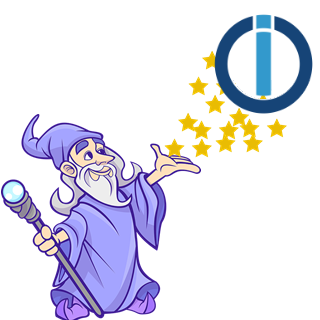

# ioBroker.state-machine

[](https://www.npmjs.com/package/iobroker.state-machine)
[](https://www.npmjs.com/package/iobroker.state-machine)


[](https://nodei.co/npm/iobroker.state-machine/)

**Tests:** 

**[English](#english) | [Deutsch](#deutsch)**

---

<a id="english"></a>

## State machine adapter for ioBroker

Model your automations as **state machines** (statecharts) in a graphical editor, similar to the
chart editors known from model based development. States, transitions with events, conditions and
actions, timers and function blocks are drawn in the ioBroker admin and executed by the adapter.

### Features

- Graphical editor as its own entry in the admin side bar
- States with `entry`, `during` and `exit` actions
- Transitions with labels in the well-known syntax `event[condition]{action}`
- Timers: `after(5, sec)`
- Function blocks with your own JavaScript functions, usable in all conditions and actions
- Inputs and outputs mapped to any ioBroker states
- Live view: the active state is highlighted in the editor
- Code editor with syntax highlighting, error checking (e.g. unknown variables) and completion
- Several independent charts per instance

### Getting started

1. Open **State Machine** in the admin side bar.
2. Create a chart with **+** in the list on the left.
3. Define the variables in the tab **Variables** on the right:
   - **Input**: read from an ioBroker state, every change wakes up the chart
   - **Output**: written to an ioBroker state when an action changes it
   - **Local**: only exists inside the chart, with an initial value
4. Add states with **Add state**. The state marked with the dot and arrow is the initial state
   (can be changed in the properties of a state).
5. Draw transitions by dragging from the border of a state to another state (or to itself).
6. Select a state or transition (or double click it) to edit its actions or label on the right.
7. Click **Save**. The adapter restarts the chart immediately.

### Example: light with motion detector

| Variable | Scope | State |
|---|---|---|
| `motion` | Input | e.g. `hm-rpc.0.ABC123.1.MOTION` |
| `light` | Output | e.g. `hue.0.hallway.on` |

| State | entry |
|---|---|
| Off (initial state) | `light = false;` |
| On | `light = true;` |

| Transition | Label |
|---|---|
| Off → On | `motion[motion == true]` |
| On → Off | `after(2, min)[!motion]` |

### Transition labels

```
event[condition]{action}
```

All parts are optional and may span several lines.

| Part | Meaning | Example |
|---|---|---|
| `event` | Name of an input: the transition is only checked when this input changes | `motion` |
| `after(n, unit)` | Instead of an event: the transition is taken *n* units after entering the state. Units: `msec`, `sec`, `min` | `after(30, sec)` |
| `[condition]` | JavaScript expression, the transition is only taken if it is true | `[temp > 21 && !window]` |
| `{action}` | JavaScript, executed when the transition is taken | `{count++; light = true;}` |

Without event, a transition is checked whenever any input changes. If a state has several outgoing
transitions, they are checked in the order of their **priority** (shown at the arrow).

### Actions

Actions and conditions are JavaScript. All variables of the chart can be used directly by their name,
plus `Math`, `Date`, `JSON` etc. and `log("text")` to write to the ioBroker log.

| Action | Executed |
|---|---|
| `entry` | when the state is entered |
| `during` | on every wakeup of the chart while the state is active and no transition is taken |
| `exit` | when the state is left |

### Function blocks

**Add function** creates a block for your own JavaScript. It is executed once when the chart starts,
all functions and constants declared in it can be used in every condition and action of the chart:

```js
const LIMIT = 22;

function tooWarm(temp) {
    return temp > LIMIT;
}
```

Transition label: `[tooWarm(temperature)]{heating = false;}`

### States created by the adapter

For every chart, the adapter creates below `state-machine.<instance>.charts.<chart>`:

| State | Content |
|---|---|
| `activeState` | Name of the active state, nested states as `Parent.Child` |
| `activeStateIds` | IDs of all active states as JSON |

The chart itself is stored in the object `state-machine.<instance>.charts.<chart>`.

### Execution model and differences to other statechart tools

- The adapter uses [XState](https://stately.ai/docs/xstate) to execute the charts.
- Every change of an input wakes up the chart once. Transitions without event are checked on every wakeup.
- `{action}` is executed while the transition is taken, i.e. after `exit` of the old and before `entry` of
  the new state. A separate condition action and `/action` are not supported (yet).
- With nested states, the transitions of the inner state are checked before those of the outer state.
- Temporal logic is limited to `after(n, msec|sec|min)`.
- Conditions and actions use JavaScript, not MATLAB/C syntax.

### Limitations

- Nested and parallel states are supported by the execution, but cannot be drawn in the editor yet.
- Unsaved changes are lost when you select another chart.
- Conditions and actions run in a separate JavaScript context with a time limit of 1 second, but this
  is **no security sandbox**: everyone who may edit charts can execute any code in the adapter,
  just like with the JavaScript adapter.

---

<a id="deutsch"></a>

## Zustandsautomaten-Adapter für ioBroker

Bilde deine Automatisierungen als **Zustandsautomaten** (Statecharts) in einem grafischen Editor ab,
ähnlich den Chart-Editoren aus der modellbasierten Entwicklung. Zustände, Übergänge mit Events,
Bedingungen und Aktionen, Timer und Funktionsblöcke werden im ioBroker-Admin gezeichnet und vom
Adapter ausgeführt.

### Funktionen

- Grafischer Editor als eigener Eintrag in der Seitenleiste des Admins
- Zustände mit `entry`-, `during`- und `exit`-Aktionen
- Übergänge mit Beschriftungen in der bekannten Syntax `event[bedingung]{aktion}`
- Timer: `after(5, sec)`
- Funktionsblöcke mit eigenen JavaScript-Funktionen, nutzbar in allen Bedingungen und Aktionen
- Eingänge und Ausgänge, die mit beliebigen ioBroker-Datenpunkten verbunden sind
- Live-Ansicht: Der aktive Zustand wird im Editor hervorgehoben
- Code-Editor mit Syntax-Hervorhebung, Fehlerprüfung (z.B. unbekannte Variablen) und Autovervollständigung
- Mehrere unabhängige Charts pro Instanz

### Erste Schritte

1. In der Seitenleiste des Admins **Zustandsmaschine** öffnen.
2. Links in der Liste mit **+** ein Chart anlegen.
3. Rechts im Reiter **Variablen** die Variablen festlegen:
   - **Eingang**: wird aus einem ioBroker-Datenpunkt gelesen, jede Änderung weckt das Chart auf
   - **Ausgang**: wird in einen ioBroker-Datenpunkt geschrieben, wenn eine Aktion ihn ändert
   - **Lokal**: gibt es nur im Chart, mit einem Startwert
4. Mit **Zustand hinzufügen** Zustände anlegen. Der Zustand mit Punkt und Pfeil ist der Startzustand
   (änderbar in den Eigenschaften eines Zustands).
5. Übergänge zeichnen: vom Rand eines Zustands zu einem anderen Zustand (oder zu sich selbst) ziehen.
6. Einen Zustand oder Übergang anklicken (oder doppelklicken), um rechts seine Aktionen bzw. seine
   Beschriftung zu bearbeiten.
7. **Speichern** klicken. Der Adapter startet das Chart sofort neu.

### Beispiel: Licht mit Bewegungsmelder

| Variable | Art | Datenpunkt |
|---|---|---|
| `motion` | Eingang | z.B. `hm-rpc.0.ABC123.1.MOTION` |
| `light` | Ausgang | z.B. `hue.0.flur.on` |

| Zustand | entry |
|---|---|
| Aus (Startzustand) | `light = false;` |
| An | `light = true;` |

| Übergang | Beschriftung |
|---|---|
| Aus → An | `motion[motion == true]` |
| An → Aus | `after(2, min)[!motion]` |

### Beschriftung von Übergängen

```
event[bedingung]{aktion}
```

Alle Teile sind optional und dürfen über mehrere Zeilen gehen.

| Teil | Bedeutung | Beispiel |
|---|---|---|
| `event` | Name eines Eingangs: Der Übergang wird nur geprüft, wenn sich dieser Eingang ändert | `motion` |
| `after(n, einheit)` | Statt eines Events: Der Übergang wird *n* Einheiten nach Betreten des Zustands genommen. Einheiten: `msec`, `sec`, `min` | `after(30, sec)` |
| `[bedingung]` | JavaScript-Ausdruck, der Übergang wird nur genommen, wenn er wahr ist | `[temp > 21 && !fenster]` |
| `{aktion}` | JavaScript, wird ausgeführt, wenn der Übergang genommen wird | `{zaehler++; licht = true;}` |

Ohne Event wird ein Übergang bei jeder Änderung eines beliebigen Eingangs geprüft. Hat ein Zustand
mehrere ausgehende Übergänge, werden sie in der Reihenfolge ihrer **Priorität** geprüft (steht am Pfeil).

### Aktionen

Aktionen und Bedingungen sind JavaScript. Alle Variablen des Charts sind direkt über ihren Namen
verfügbar, dazu `Math`, `Date`, `JSON` usw. sowie `log("Text")` zum Schreiben ins ioBroker-Log.

| Aktion | Wird ausgeführt |
|---|---|
| `entry` | beim Betreten des Zustands |
| `during` | bei jedem Aufwecken des Charts, solange der Zustand aktiv ist und kein Übergang genommen wird |
| `exit` | beim Verlassen des Zustands |

### Funktionsblöcke

**Funktion hinzufügen** legt einen Block für eigenes JavaScript an. Er wird beim Start des Charts
einmal ausgeführt. Alle darin deklarierten Funktionen und Konstanten können in jeder Bedingung und
Aktion des Charts verwendet werden:

```js
const LIMIT = 22;

function zuWarm(temp) {
    return temp > LIMIT;
}
```

Beschriftung eines Übergangs: `[zuWarm(temperatur)]{heizung = false;}`

### Vom Adapter angelegte Datenpunkte

Für jedes Chart legt der Adapter unter `state-machine.<instanz>.charts.<chart>` an:

| Datenpunkt | Inhalt |
|---|---|
| `activeState` | Name des aktiven Zustands, verschachtelte Zustände als `Eltern.Kind` |
| `activeStateIds` | IDs aller aktiven Zustände als JSON |

Das Chart selbst ist im Objekt `state-machine.<instanz>.charts.<chart>` gespeichert.

### Ausführung und Unterschiede zu anderen Statechart-Werkzeugen

- Der Adapter führt die Charts mit [XState](https://stately.ai/docs/xstate) aus.
- Jede Änderung eines Eingangs weckt das Chart einmal auf. Übergänge ohne Event werden bei jedem Aufwecken geprüft.
- `{aktion}` wird während des Übergangs ausgeführt, also nach `exit` des alten und vor `entry` des
  neuen Zustands. Eine eigene Condition Action und `/aktion` werden (noch) nicht unterstützt.
- Bei verschachtelten Zuständen werden die Übergänge des inneren Zustands vor denen des äußeren geprüft.
- Zeitlogik gibt es nur als `after(n, msec|sec|min)`.
- Bedingungen und Aktionen sind JavaScript, nicht MATLAB- oder C-Syntax.

### Einschränkungen

- Verschachtelte und parallele Zustände kann die Ausführung schon, sie lassen sich im Editor aber
  noch nicht zeichnen.
- Ungespeicherte Änderungen gehen verloren, wenn ein anderes Chart ausgewählt wird.
- Bedingungen und Aktionen laufen in einem eigenen JavaScript-Kontext mit 1 Sekunde Zeitlimit, das
  ist aber **keine Sicherheits-Sandbox**: Wer Charts bearbeiten darf, kann im Adapter beliebigen Code
  ausführen, wie beim JavaScript-Adapter auch.

---

## Development / Entwicklung

```bash
npm install
npm run build             # build the admin tab
npx dev-server setup      # once: local ioBroker test instance in .dev-server/
npx dev-server watch      # run it, admin on http://127.0.0.1:8081/
```

| Script | Description |
|---|---|
| `build` / `watch` | Build the React sources of the tab (`admin/src`) to `admin/build` |
| `upload:tab` | Build the tab and write the admin files into the running dev-server instance (works while `dev-server watch` runs) |
| `test` | Unit tests (`lib/**/*.test.js`) and package tests |
| `check` | Type check of the adapter (`npx tsc -p admin/tsconfig.json --noEmit` for the tab) |
| `lint` | ESLint |
| `translate` | Translate the texts of the adapter |
| `release` | Create a new release |

After changes of `io-package.json`, run `npx dev-server upload` and restart `npx dev-server watch`.

| Path | Content |
|---|---|
| `main.js` | Adapter: loads the charts, subscribes the inputs, restarts a chart when it is saved |
| `lib/chart-model.js` | Chart model (shared by adapter and editor) and parser of the transition labels |
| `lib/chart-runtime.js` | Execution of a chart with XState |
| `lib/chart-validation.js` | Checks of conditions, actions and function blocks |
| `admin/src/` | Editor (React, React Flow, CodeMirror) |
| `admin/jsonConfig.json` | Instance settings |

## Disclaimer

MATLAB and Stateflow are registered trademarks of The MathWorks, Inc. This adapter is not affiliated
with, endorsed or sponsored by The MathWorks, Inc.

## Changelog
<!--
    Placeholder for the next version (at the beginning of the line):
    ### **WORK IN PROGRESS**
-->

### **WORK IN PROGRESS**
* (Igge) initial release: graphical chart editor, execution with XState, timers, function blocks, code checks

## License
MIT License

Copyright (c) 2026 Igge <mail@igge.org>

Permission is hereby granted, free of charge, to any person obtaining a copy
of this software and associated documentation files (the "Software"), to deal
in the Software without restriction, including without limitation the rights
to use, copy, modify, merge, publish, distribute, sublicense, and/or sell
copies of the Software, and to permit persons to whom the Software is
furnished to do so, subject to the following conditions:

The above copyright notice and this permission notice shall be included in all
copies or substantial portions of the Software.

THE SOFTWARE IS PROVIDED "AS IS", WITHOUT WARRANTY OF ANY KIND, EXPRESS OR
IMPLIED, INCLUDING BUT NOT LIMITED TO THE WARRANTIES OF MERCHANTABILITY,
FITNESS FOR A PARTICULAR PURPOSE AND NONINFRINGEMENT. IN NO EVENT SHALL THE
AUTHORS OR COPYRIGHT HOLDERS BE LIABLE FOR ANY CLAIM, DAMAGES OR OTHER
LIABILITY, WHETHER IN AN ACTION OF CONTRACT, TORT OR OTHERWISE, ARISING FROM,
OUT OF OR IN CONNECTION WITH THE SOFTWARE OR THE USE OR OTHER DEALINGS IN THE
SOFTWARE.
